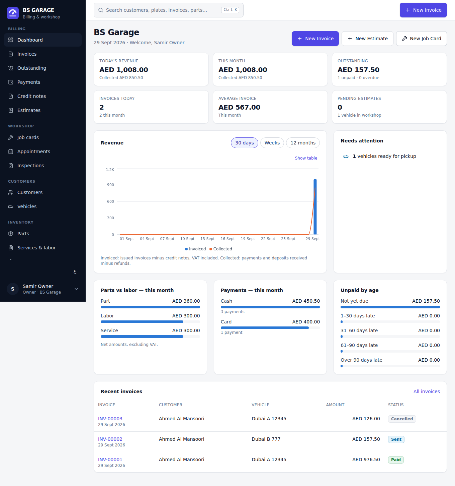
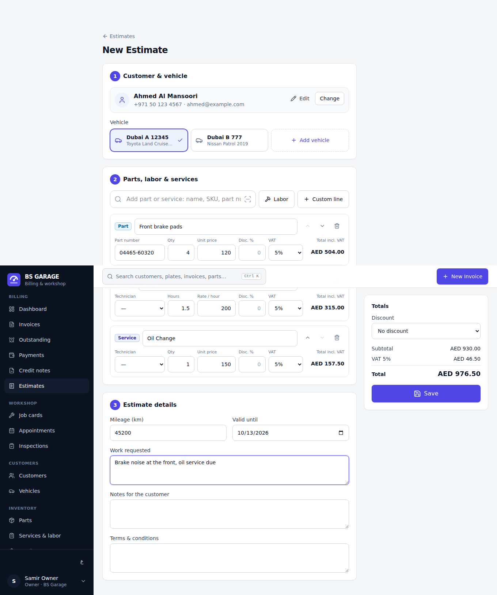
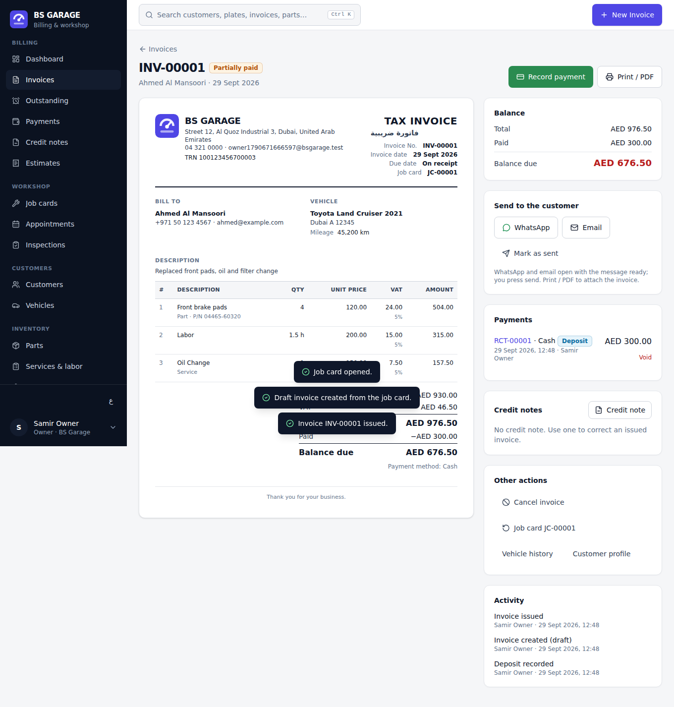
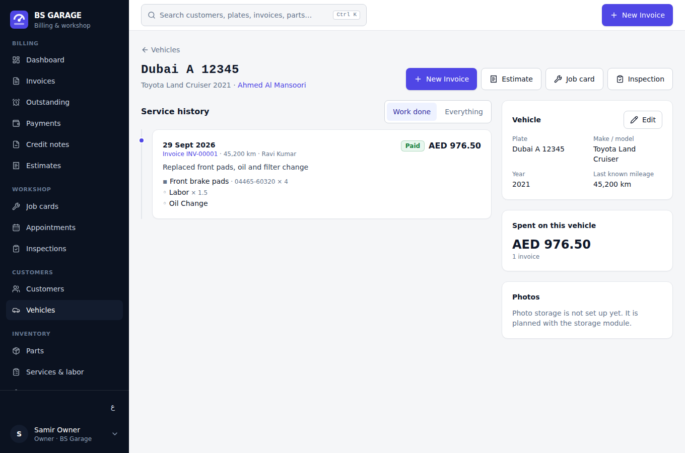
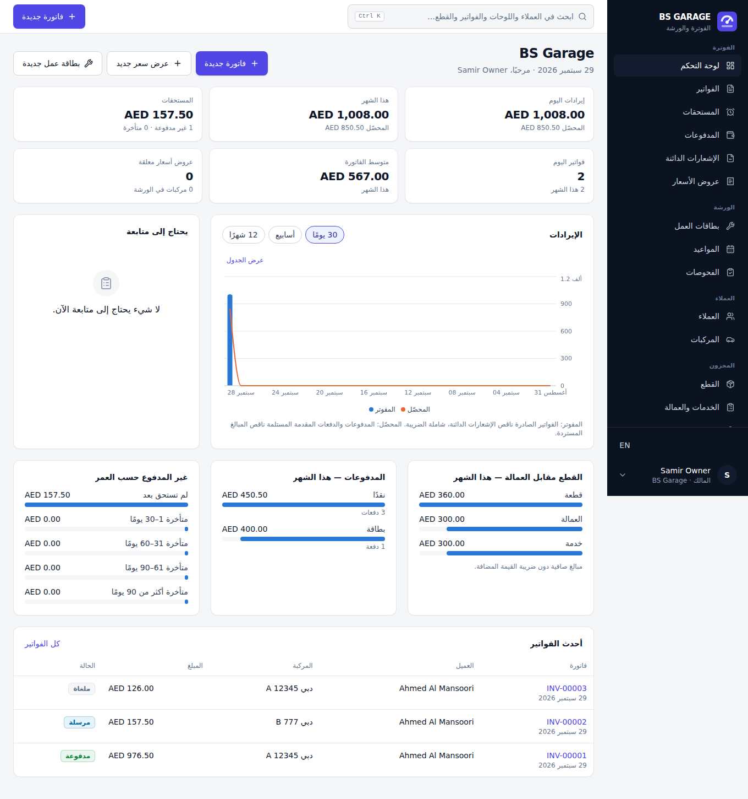
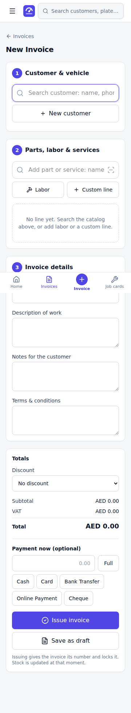

# BS Garage

Billing-first management software for an automotive garage in Dubai.
Invoices, payments, receipts, deposits, credit notes and refunds are the core;
customers, vehicles, estimates, job cards, parts, stock, suppliers,
appointments, inspections and reports exist to make billing fast and exact.

The design decisions are in [`docs/ARCHITECTURE.md`](docs/ARCHITECTURE.md).

| Dashboard | Estimate / invoice editor | Issued tax invoice |
| --- | --- | --- |
|  |  |  |
| **Vehicle history** | **Arabic (RTL)** | **Phone: new invoice** |
|  |  |  |

Screenshots are taken by the end-to-end test from real data it creates.

## What works today

| Area | What you can do |
| --- | --- |
| **Invoices** | One-screen "+ New Invoice": find the customer by name, phone, plate or VIN (or create them inline), pick the vehicle, add parts (name, SKU, part number, barcode scanner), labor hours and services, line and document discounts, live VAT; issue and take payment in one click. Drafts, gapless numbering at issue, immutable issued invoices, cancellation with reason, status filters, CSV export. |
| **Payments** | Cash, card, bank transfer, online, cheque and your own methods. Partial and multiple payments, reference, date, user, notes. Numbered receipts, printable. Voiding with reason (receipt kept, marked void). |
| **Deposits** | Taken on an estimate, a job card or a draft invoice; follow the work and are deducted automatically from the final invoice; refundable if the job is abandoned. |
| **Credit notes & refunds** | By lines (quantities, parts back to stock) or by amount (goodwill). Never more than invoiced. Refund when the customer is owed money. |
| **Outstanding** | Balance, days overdue, filters (issued today, week, month, overdue, large amounts), payment in one click, WhatsApp/email reminders with the last reminder date. |
| **Estimates** | Statuses draft / sent / pending / approved / rejected / expired / converted. One click to approve and open the job card, or to invoice directly. Nothing is typed twice. |
| **Job cards** | Mechanic assignment, promised time and delays, workshop progress (open → in progress → waiting parts → ready → delivered), diagnosis and work done, "vehicle ready" message, one click to invoice. |
| **Customers & vehicles** | Individuals and companies (TRN, trade licence), UAE plates (emirate, code, number), VIN, mileage. Customer profile with vehicles, invoices, estimates, job cards, payments, total spent, outstanding. Vehicle service history. Duplicate-plate warning. |
| **Parts, services, stock** | Catalog with cost, price, margin, VAT rate, minimum stock, location, barcode, supplier. Stock per branch, moved only by recorded movements (sale at issue, return on cancel/credit, receipt from supplier, in/out/adjustment/count), low-stock alerts. |
| **Suppliers** | Contacts, supplier prices, purchase orders (draft → ordered → partially received → received), receiving adds stock and updates costs, purchase history. |
| **Appointments** | Day / week / month calendar, statuses, mechanic, reminder by WhatsApp, open a job card from the appointment. |
| **Inspections** | 11 checks (tyres, brakes, battery, oil, coolant, suspension, lights, AC, engine, transmission, body) marked OK / attention / urgent with comments, recommendations, printable report, WhatsApp summary. |
| **Dashboard & reports** | Today's and month's revenue, collected, outstanding, average invoice, estimates waiting, vehicles in workshop, needs-attention list, revenue by day/week/month, parts vs labor, payments by method, unpaid by age. Reports by period (today to custom range): VAT on sales, credit notes, refunds, revenue per mechanic / service / customer, CSV export, print. |
| **Documents** | Tax invoice / invoice, estimate, job card, payment and refund receipts, credit note, inspection report, purchase order. A4, garage branding, TRN. Print or save as PDF from the browser. |
| **Team & permissions** | Owner, admin, manager, service advisor, mechanic, accountant. Enforced by the database; the interface reads the same permission table. Invitations by email. |
| **Audit log** | Who did what and when: invoices, payments, voids, credit notes, estimates, stock, prices, settings, team. Append-only. |
| **Multi-garage, multi-branch** | Each garage is isolated by row-level security. Branches have their own stock and documents; a branch selector filters every screen. |
| **Languages** | English and Arabic (right-to-left), every string translated. |
| **Import / export** | CSV import of customers, vehicles, parts with stock, suppliers (with validation and preview). CSV export of every list and report. |

## Deliberately not built yet

Listed so that nothing looks like it works when it does not (details in the
architecture document, section 11):

- photos on inspections and job cards, customer signature capture;
- sending by the server (WhatsApp Business API, SMS, email): today the app
  opens WhatsApp or the email app with the message ready, and logs it;
- Excel `.xlsx` files (CSV is used; Excel opens and saves CSV);
- server-generated PDF files (the browser saves the print view as PDF);
- restricting a user to a single branch.

## Run it locally

Requirements: Node 22, PostgreSQL 16 binaries (`/usr/lib/postgresql/16/bin`),
and the PostgREST binary once:

```sh
cd garage
npm install            # or: bun install
mkdir -p .stack/bin && curl -sSL https://github.com/PostgREST/postgrest/releases/download/v12.2.3/postgrest-v12.2.3-linux-static-x64.tar.xz | tar -xJ -C .stack/bin
npm run stack          # Postgres + PostgREST + local auth, writes .stack/.env.local
npm run dev            # in another terminal: http://127.0.0.1:5173
```

Create an account, set up the garage, and start invoicing. The local stack
starts empty every time: there is no demo data.

## Tests

```sh
npm test               # pure modules: totals, VAT, rounding, plates, phones, search, CSV, dates, translations
npm run test:db        # real Postgres: full workflow, tenant isolation, role matrix, TS/SQL totals equivalence
npm run test:e2e       # real browser: the whole journey, permissions, Arabic, 25 screens at 360/768/1024/1440 px
npm run typecheck && npm run lint && npm run build
```

`test:e2e` needs Playwright's Chromium. Screenshots are written to
`test-results/`.

## Deploy

1. **Database.** Create a Supabase project. Apply the migrations of
   `garage/supabase/migrations` in order (for example
   `supabase link --project-ref <ref> --workdir garage` then
   `supabase db push --workdir garage`). Do not apply `dev/supabase-shim.sql`:
   it only imitates Supabase for local tests.
2. **Auth.** In Supabase Auth, enable email sign-in. With email confirmation
   on, new users confirm their address before signing in; the app handles
   both cases.
3. **Frontend.** Build with the project's public URL and anon key:

   ```sh
   VITE_SUPABASE_URL=https://<ref>.supabase.co VITE_SUPABASE_ANON_KEY=<anon key> npm run build
   ```

   Serve `dist/` from any static host (Cloudflare Pages, Netlify, S3…) with a
   single-page fallback to `index.html`. No server secret is needed: every rule
   is enforced by the database.

## VAT and compliance

The garage enters its VAT registration and rates; nothing is hard-coded.
BS Garage applies these settings consistently (integer arithmetic, one
rounding per rate, identical in the preview and in the database). It does not
claim compliance with any regulation: tax settings and document requirements
must be confirmed with the garage's accountant or the tax authority.
